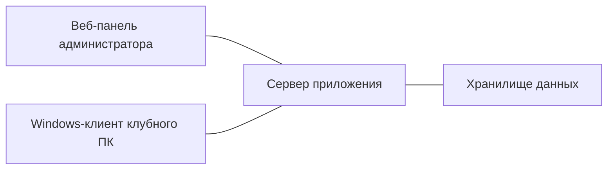

# COREX

COREX — мой проект, B2B-система для управления компьютерными клубами. Веб-панель помогает администратору видеть занятость зала, управлять игровыми сессиями и работать с бронированиями. На клубных ПК работает Windows-клиент с интерфейсом для гостя.

## Пример работы

Целевой сценарий: администратор видит свободные и занятые места на карте зала и управляет игровой сессией на выбранном ПК. Гость пользуется интерфейсом клубного ПК во время сессии, а администратор следит за её состоянием в веб-панели.

## Архитектура

- **Веб-панель** объединяет карту зала, игровые сессии и бронирования.
- **Сервер** хранит состояние клуба и согласует работу панели с клиентами.
- **Windows-клиент** показывает гостевой интерфейс и отражает состояние игровой сессии на ПК.

## Технологии

- **Сервер и данные** — Python, FastAPI, SQLAlchemy, PostgreSQL.
- **Веб-панель** — HTML, CSS и JavaScript.
- **Windows-клиент** — C#/.NET, WPF и C++.

## Статус

Проект в разработке. Описание выше показывает назначение системы; готовность отдельных сценариев различается.

### Срез на 12 ноября 2026 года

- Развиваются учётные записи гостей, членство в клубах и поддержка организаций.
- В локальной ветке разработки добавлены основа организаций и дополнительные проверки изоляции данных между клубами. Эти изменения ещё не опубликованы в удалённых ветках основного проекта.
- Следующий срез по программе лояльности находится в локальной работе; завершённым релизом он пока не является.
- Windows-интерфейс и интеграция продолжают разрабатываться. Готовность самостоятельного запуска платной сессии гостем и эксплуатации с реальными платежами пока не подтверждена.

Публичный репозиторий содержит только описание проекта. Исходный код основного проекта остаётся приватным.
