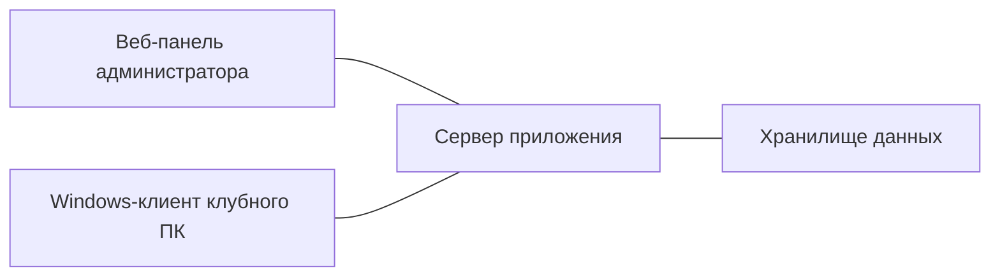

# COREX

COREX — мой проект, B2B-система для управления компьютерными клубами. Веб-панель помогает администратору видеть занятость зала, управлять игровыми сессиями и работать с бронированиями. На клубных ПК работает Windows-клиент с интерфейсом для гостя.

## Пример работы

Администратор видит свободные и занятые места на карте зала и запускает игровую сессию на выбранном ПК. Гость пользуется интерфейсом клубного ПК во время сессии, а администратор следит за её состоянием в веб-панели.

## Архитектура

- **Веб-панель** объединяет карту зала, игровые сессии и бронирования.
- **Сервер** хранит состояние клуба и согласует работу панели с клиентами.
- **Windows-клиент** показывает гостевой интерфейс и отражает состояние игровой сессии на ПК.

## Технологии

- **Сервер и данные** — Python, FastAPI, SQLAlchemy, PostgreSQL.
- **Веб-панель** — HTML, CSS и JavaScript.
- **Windows-клиент** — C#/.NET, WPF и C++.

## Статус

Проект в разработке. В портфолио описаны сценарии, представленные в текущей версии проекта.
